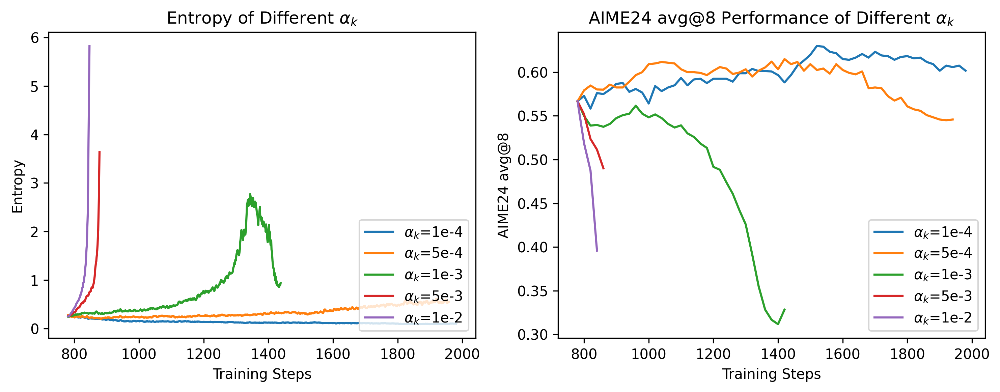
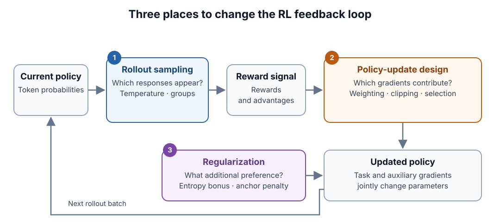
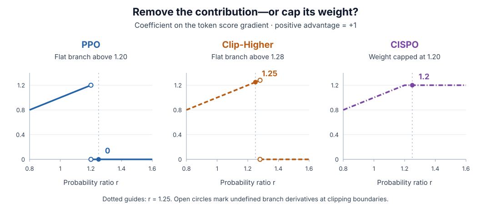

## When concentration helps—and when it stalls RL {#opening}

An RL policy generates its own training data. Once an update makes some responses more likely, the next rollout batch tends to contain more of them. Their rewards drive another update, which changes the next batch again. Learning depends on this feedback loop continuing to produce useful evidence.

Concentration is part of successful learning: a model should become more reliable at decisions it has learned to make correctly. But it can also concentrate too early. If a narrow set of responses dominates before the task is solved well, better alternatives may become too unlikely to appear in the rollout budget. Training then has fewer opportunities to discover and reinforce them.

Adding randomness addresses only part of that problem. More varied responses can expose useful alternatives, or simply produce more invalid answers. An intervention that raises entropy while degrading the learning signal has not solved the underlying failure.

### The empirical problem

Skywork-OR1 provides a concrete example. Figure 1 shows the fixed-coefficient ablation reported by the Skywork-OR1 authors: at $10^{-4}$, entropy declines while AIME24 performance improves and then largely plateaus. Larger coefficients do not simply preserve useful exploration. The $10^{-3}$, $5\times10^{-3}$, and $10^{-2}$ runs show sharp entropy growth alongside severe performance degradation; at $5\times10^{-4}$, entropy rises more gradually while performance eventually declines. The low-entropy run remains the strongest of these runs at the end of the plotted window—low entropy alone is not evidence of failed learning. [[1]][source-1]

*Figure 1. Entropy and AIME24 performance under different fixed entropy-bonus coefficients. Original figure from He et al., Skywork Open Reasoner 1 Technical Report, Figure 19 (§4.5). [[1]][source-1]*

The report's Figure 20 also shows opposite entropy trends after changing only the math dataset, with the coefficient held at $10^{-3}$. Together, these results motivate adaptive control and show why a fixed coefficient is difficult to transfer. The paired entropy and evaluation curves—not the entropy curve alone—establish whether an intervention helps. [[1]][source-1]

The useful distinction is between productive and unproductive changes in the policy:

| Observed behavior | Possible interpretation |
| :--- | :--- |
| Entropy falls while held-out success improves | Productive concentration on better responses |
| Entropy falls rapidly, progress stalls, and sampled responses become repetitive | Premature concentration that may limit further learning |
| Entropy rises while useful solutions and performance improve | Productive exploration |
| Entropy rises while validity or performance deteriorates | Unproductive dispersion |

These are patterns to interpret, not diagnoses from curve shape. Low entropy on a mastered problem is not a failure. Nor is declining entropy a requirement for progress: *Revisiting Entropy* reports experiments in which accuracy improves while adaptive regularization maintains entropy near a reference level. [[10]][source-10]

The practical objective is therefore to make successful behavior more reliable without prematurely eliminating useful learning opportunities. Entropy is relevant because it describes policy concentration and can be influenced during training. It is not itself a measure of correctness or the number of distinct reasoning strategies.

This post focuses on outcome-reward RL, particularly math and coding with verifiable rewards. Its main examples are reported training recipes and ablations; narrower research variants illustrate additional design choices.

- [How RL updates change entropy](#dynamics): the derivatives behind concentration and dispersion.
- [Shaping the policy update](#task-update): which reward-driven gradients survive and how strongly they count.
- [Entropy regularization](#regularization): bonuses, targets, and feedback.
- [Exploration through rollout sampling](#collection): obtaining more informative training responses.
- [Evaluating the result](#outcomes): reliability, coverage, and the limits of the entropy curve.

## How RL updates change entropy {#dynamics}

### From a sampled reward to a logit update

At a fixed prefix $s=(x,y_{<t})$, let $z_i$ be the logit for vocabulary item $i$ and

$$
p_i=p_\theta(i\mid s)=\frac{e^{z_i}}{\sum_k e^{z_k}},
\qquad
H(p)=-\sum_i p_i\log p_i.
$$ {#eq-policy-entropy}

Natural logarithms give entropy in nats. This is uncertainty over the next-token distribution at one prefix. A training curve averages such quantities over many prefixes, usually from changing rollouts.

For a sampled action $a$ with a detached advantage $\hat A$, the unclipped score-function surrogate is $J_{\mathrm{sample}}=\hat A\log p_a$. Since

$$
\log p_a=z_a-\log\sum_i e^{z_i},
$$

its derivative is

$$
\frac{\partial \log p_a}{\partial z_j}
=\mathbf 1[j=a]-\frac{e^{z_j}}{\sum_i e^{z_i}}
=\mathbf 1[j=a]-p_j.
$$ {#eq-score-gradient}

Under plain gradient ascent on independently trainable logits,

$$
\Delta z_j
=\eta\hat A\bigl(\mathbf 1[j=a]-p_j\bigr).
$$ {#eq-logit-update}

Reinforcement changes all logits through softmax normalization, not just the sampled action's logit. With two actions initially at $(p_A,p_B)=(0.8,0.2)$ and $\eta=0.1$:

| Sample and advantage | $(\Delta z_A,\Delta z_B)$ | New $p_A$ | New entropy |
| :--- | :--- | :--- | :--- |
| $A$, $\hat A=+1$ | $(+0.02,-0.02)$ | 0.8063 | 0.4915 |
| $A$, $\hat A=-1$ | $(-0.02,+0.02)$ | 0.7935 | 0.5093 |
| $B$, $\hat A=+1$ | $(-0.08,+0.08)$ | 0.7732 | 0.5354 |
| $B$, $\hat A=-1$ | $(+0.08,-0.08)$ | 0.8244 | 0.4647 |

*Calculated example: exact softmax evaluations after one logit step, from an initial entropy of 0.5004 nats.*

Reinforcing the dominant action lowers entropy here; reinforcing the less likely action raises it. Advantage sign alone does not determine entropy direction.

If $A$ is correct and $B$ is wrong, expected reward is $p_A$. Moving $p_A$ from $0.2$ through $0.5$ to $0.8$ improves reward throughout, while entropy first rises and then falls. The same learning objective can produce either direction depending on where probability starts.

### From a logit update to an entropy change

The softmax derivative follows directly from the quotient rule:

$$
\frac{\partial p_i}{\partial z_j}
=\frac{\mathbf 1[i=j]e^{z_i}\sum_k e^{z_k}-e^{z_i}e^{z_j}}
{\left(\sum_k e^{z_k}\right)^2}
=p_i\bigl(\mathbf 1[i=j]-p_j\bigr).
$$

Substituting it into the entropy derivative gives

$$
\begin{aligned}
\frac{\partial H}{\partial z_j}
&=-\sum_i(\log p_i+1)\frac{\partial p_i}{\partial z_j}\\
&=-p_j(\log p_j+1)
+p_j\sum_i p_i(\log p_i+1)\\
&=-p_j(\log p_j+1)+p_j(1-H)\\
&=-p_j(\log p_j+H).
\end{aligned}
$$ {#eq-entropy-logit-gradient}

The third line uses $\sum_i p_i=1$ and $\sum_i p_i\log p_i=-H$. A first-order expansion now connects an actual logit displacement to entropy:

$$
\begin{aligned}
\Delta H
&=\sum_j\frac{\partial H}{\partial z_j}\Delta z_j
+O(\|\Delta z\|^2)\\
&=-\mathbb E_{j\sim p}[\log p_j\,\Delta z_j]
-H\,\mathbb E_{j\sim p}[\Delta z_j]
+O(\|\Delta z\|^2)\\
&=-\left(
\mathbb E_p[\log p\,\Delta z]
-\mathbb E_p[\log p]\mathbb E_p[\Delta z]
\right)
+O(\|\Delta z\|^2)\\
&=-\operatorname{Cov}_{j\sim p}(\log p_j,\Delta z_j)
+O(\|\Delta z\|^2).
\end{aligned}
$$ {#eq-entropy-covariance}

Entropy decreases to first order when the update preferentially raises logits of already likely actions. It increases when the displacement favors less likely actions. The covariance is over vocabulary actions at a fixed prefix and uses their actual logit changes.

The distinction matters when connecting this identity to advantages. At one fixed prefix, assume independently trainable logits, on-policy sampling, and true centered advantages $A_j$ with $\sum_j p_jA_j=0$. Taking the expectation of @eq-logit-update gives

$$
\begin{aligned}
\mathbb E[\Delta z_j]
&=\eta\sum_a p_aA_a\bigl(\mathbf 1[j=a]-p_j\bigr)\\
&=\eta p_jA_j.
\end{aligned}
$$ {#eq-ordinary-pg-logit-change}

Ordinary policy gradient therefore weights the advantage by the action's probability. Natural policy gradient changes this geometry: the categorical Fisher matrix is $F=\operatorname{diag}(p)-pp^\top$, and $FA=pA$ for centered advantages. Its logit direction is consequently $A$, up to a common shift that leaves softmax probabilities unchanged. Substitution into @eq-entropy-covariance gives, to first order,

$$
\begin{aligned}
\mathbb E[\Delta H]_{\mathrm{PG}}
&\approx-\eta\operatorname{Cov}_{j\sim p}(\log p_j,p_jA_j),\\
\mathbb E[\Delta H]_{\mathrm{NPG}}
&\approx-\eta\operatorname{Cov}_{j\sim p}(\log p_j,A_j).
\end{aligned}
$$ {#eq-pg-npg-entropy}

These are the distinct tabular results in *The Entropy Mechanism*, §3.2. Substituting advantage directly for logit displacement assumes the natural-gradient geometry; PPO with estimated group advantages and Adam on a shared transformer does not automatically follow either tabular update. [[5]][source-5]

In a neural model, parameters are shared across prefixes and vocabulary items:

$$
\Delta H_\theta(s)
\approx\nabla_\theta H_\theta(s)^\top\Delta\theta.
$$ {#eq-parameter-entropy-change}

Gradients from other responses and the optimizer influence $\Delta\theta$. The binary example isolates the mechanism; it does not predict a transformer's entire training trajectory. At an exactly uniform distribution, the first-order entropy gradient is zero, but a finite update can still reduce entropy through higher-order terms.

A logged curve also changes because the policy visits different prefixes. Let $H_k(s)$ be conditional entropy at checkpoint $k$, and let $d_k(s)$ be the normalized prefix distribution induced by the logging procedure, including its token or response weighting. With $\bar H_k=\mathbb E_{s\sim d_k}[H_k(s)]$, adding and subtracting $\mathbb E_{d_k}[H_{k+1}]$ gives the exact decomposition

$$
\begin{aligned}
\bar H_{k+1}-\bar H_k
={}&\underbrace{\mathbb E_{d_k}[H_{k+1}-H_k]}_{\text{policy change at fixed prefixes}}\\
&+\underbrace{\sum_s\bigl(d_{k+1}(s)-d_k(s)\bigr)H_{k+1}(s)}_{\text{change in measured prefixes}}.
\end{aligned}
$$ {#eq-logged-entropy-change}

The local derivative describes the first term. The second can change the aggregate curve even when entropy on a fixed set of prefixes stays constant. This identity concerns the underlying means; finite-sample estimates introduce additional noise.

### Why the next rollout batch matters

The consequence of concentration is operational. If a useful response family has sampling probability $\varepsilon$, its chance of appearing in $K$ independent rollouts is $1-(1-\varepsilon)^K$. With $\varepsilon=10^{-4}$ and $K=8$, that is about $0.08\%$. Nonzero probability can still mean practically unavailable training evidence.

The three intervention points address different parts of this loop:

*Figure 2. Three intervention points in the RL feedback loop. Blue changes the sampled evidence, orange changes how task feedback is used, and purple adds a preference beyond task reward. The updated policy closes the loop.*

They are not interchangeable entropy controllers. A sampling change may improve reward comparisons without increasing model entropy; an update change may preserve useful gradients without specifying any target entropy.

## Shaping the policy update {#task-update}

A rare successful response is useful only if its feedback can change the policy. Clipping, normalization, and selection determine how much of that feedback survives. They can also change how aggressively already common behavior is reinforced.

### PPO and DAPO: retaining useful positive updates

Let $\pi_{\mathrm{old}}$ be the frozen old-policy anchor and define the recorded-token ratio

$$
r(\theta)=\frac{\pi_\theta(a\mid s)}{\pi_{\mathrm{old}}(a\mid s)}.
$$ {#eq-importance-ratio}

For this comparison, assume the rollout sampler uses the same old-policy distribution as the denominator. Temperature or filtering can break that match, as discussed in [rollout sampling](#collection). With a detached advantage, the maximized PPO term is

$$
u_{\mathrm{PPO}}
=\min\!\left(r\hat A,\operatorname{clip}(r,\ell,h)\hat A\right),
\qquad
\ell=1-\epsilon_{\mathrm{low}},\quad h=1+\epsilon_{\mathrm{high}}.
$$ {#eq-ppo-objective}

On an active branch, $\nabla_\theta r=r\nabla_\theta\log\pi_\theta(a\mid s)$. On a flat branch, the direct derivative vanishes. Thus, away from boundaries,

$$
\nabla_\theta u_{\mathrm{PPO}}
=
\begin{cases}
r\hat A\,\nabla_\theta\log\pi_\theta(a\mid s),
&\hat A>0,\ r<h,\\
r\hat A\,\nabla_\theta\log\pi_\theta(a\mid s),
&\hat A<0,\ r>\ell,\\
0,&\text{otherwise}.
\end{cases}
$$ {#eq-ppo-gradient}

Clipping removes a token's direct contribution, rather than imposing a hard constraint on its probability. Other loss terms still move shared parameters. [[2]][source-2]

The DAPO authors motivate Clip-Higher with entropy collapse and nearly identical sampled responses observed in their training runs. Raising the upper threshold retains positive-advantage gradients over a wider range. Its reported bounds use $\epsilon_{\mathrm{low}}=0.2$ and $\epsilon_{\mathrm{high}}=0.28$. [[3]][source-3]

For an old probability of $0.01$, a ratio threshold of $1.2$ is reached at $0.012$: a small absolute increase before that positive term becomes flat. Widening the threshold gives a rare successful token more room to learn. It also retains gradients for common successful tokens; the mechanism enables learning rather than directly maximizing entropy.

At the first matched-policy update, with identical scoring/execution, all ratios are 1 and ordinary clipping is inactive. After one optimizer step, ratios for the remaining rollout data can differ from 1, even if those responses have not yet contributed to an update. Multiple optimizer minibatches and repeated epochs both create policy drift relative to the frozen anchor. Physical gradient accumulation does not: parameters remain fixed until the optimizer step.

### CISPO: cap the weight, keep the gradient

MiniMax-M1 addresses the loss of token contributions differently. CISPO detaches the clipped ratio and multiplies it by a live log-probability:

$$
u_{\mathrm{CISPO}}
=\operatorname{sg}\!\left[\operatorname{clip}(r,\ell,h)\right]
\hat A\log\pi_\theta(a\mid s).
$$ {#eq-cispo-objective}

Consequently,

$$
\nabla_\theta u_{\mathrm{CISPO}}
=\operatorname{clip}(r,\ell,h)\hat A
\nabla_\theta\log\pi_\theta(a\mid s).
$$ {#eq-cispo-gradient}

Beyond the upper threshold, the weight stops growing but the score gradient remains. The report's experiments use no restrictive lower bound on the importance weight. Removing the stop-gradient would introduce an extra derivative through $r$, defining a different update. [[4]][source-4]

Figure 3 compares the positive-advantage branches of @eq-ppo-gradient and @eq-cispo-gradient over a range of ratios. At $r=1.25$, their coefficients are 0, 1.25, and 1.2 respectively.

*Figure 3. Analytical score-gradient coefficients for a positive advantage of +1—not objective values or measured training curves. Clipping thresholds are illustrative comparison settings. Open circles mark the undefined derivatives at PPO branch boundaries; the detached CISPO weight remains active at its cap.*

Numerical comparison at ratio 1.25

| Update rule | Coefficient on the token score gradient |
| :--- | :--- |
| PPO, upper threshold 1.2 | 0 |
| Clip-Higher, upper threshold 1.28 | 1.25 |
| CISPO, upper cap 1.2 | 1.2 |

This comparison separates three behaviors: remove the contribution, delay its removal, or retain it with a capped weight. None determines entropy direction without knowing which actions receive those gradients.

### Weighting and selection are related, but distinct

Normalization changes which samples dominate even before clipping. Dr. GRPO removes group standard-deviation scaling and response-length normalization, using fixed normalization instead. DAPO retains standardized advantages and aggregates at token level. Their effects on gradient balance should not be conflated with explicit entropy regularization. [[7]][source-7]; [[3]][source-3]

Other methods refine the unit or location of control:

| Design | What changes | Connection to entropy |
| :--- | :--- | :--- |
| GSPO [[9]][source-9] | Clips using a length-normalized sequence ratio | Changes response-level eligibility rather than token-level eligibility |
| Positive-Advantage Reweighting [[10]][source-10] | Rescales retained positive feedback | Changes reinforcement relative to negative feedback |
| High-entropy position selection [[11]][source-11] | Applies task gradients at uncertain positions | Allocates learning using current uncertainty |
| Clip-Cov / KL-Cov [[5]][source-5] | Suppresses or constrains selected updates with high batch covariance scores | Targets a proxy for concentration-driving feedback |

These are complementary research directions, not equivalent formulas for preserving diversity. In particular, high-entropy selection reinforces rewarded actions at selected positions; it does not require those positions to remain uncertain. Covariance-based methods use sampled-token batch statistics, not the exact fixed-prefix vocabulary covariance derived above. A masked token also remains part of the context and can change through shared parameters.

The common lesson is narrower: entropy can change because the task update changed, even with no entropy bonus. Whether that change helps depends on the useful feedback retained and the learning outcomes that follow.

## Entropy regularization: bonuses, targets, and feedback {#regularization}

Update rules reshape reward-driven learning. An explicit regularizer adds another preference. This can counter premature concentration, but it can also compete with making correct behavior reliable.

### A bonus changes the optimum

On a fixed batch of recorded prefixes, consider

$$
J(\theta)=J_{\mathrm{task}}(\theta)+\alpha\bar H(\theta),
\qquad \alpha\ge0.
$$ {#eq-entropy-bonus}

For two actions, with reward 1 for $A$ and 0 for $B$, write $p=P(A)$:

$$
J(p)=p+\alpha[-p\log p-(1-p)\log(1-p)].
$$

For $\alpha>0$, the stationary point satisfies

$$
\frac{dJ}{dp}
=1+\alpha\log\frac{1-p}{p}=0,
\qquad
p^*=\operatorname{sigmoid}(1/\alpha).
$$ {#eq-regularized-optimum}

The second derivative is $-\alpha/[p(1-p)]<0$, so this is the unique interior maximum. At $\alpha=1$, $p^*\approx0.7311$, rather than 1. For reward gap $\Delta R$, the argument becomes $\Delta R/\alpha$.

The bonus trades immediate reward for stochasticity. In online RL, that stochasticity can improve later data collection, but the fixed-prefix objective does not include every effect on future visited states. Sequential maximum-entropy RL, as developed in SAC, accounts for future entropy in its return/value construction. That is a useful foundation, not an equivalence between an LLM auxiliary loss and the full SAC algorithm. [[8]][source-8]

The logit-space gradient also weakens near determinism. With $p=\operatorname{sigmoid}(d)$,

$$
\frac{dH}{dd}
=\frac{dH}{dp}\frac{dp}{dd}
=\log\frac{1-p}{p}\,p(1-p).
$$ {#eq-binary-entropy-gradient}

It approaches zero as $p$ approaches either boundary. The reward gradient also vanishes in this parameterization. For reward gap $\Delta R$, $J(d)=R_B+\Delta R\,p(d)+\alpha H(p(d))$, so

$$
\frac{dJ}{dd}
=p(1-p)\bigl(\Delta R-\alpha d\bigr).
$$ {#eq-saturated-objective-gradient}

Here $\log((1-p)/p)=-d$. For fixed $\alpha>0$ and nonzero $\Delta R$, the entropy contribution relative to the reward contribution has magnitude $\alpha|d|/|\Delta R|$, which grows with saturation. Both absolute contributions nevertheless approach zero. Recovery from a saturated decision can therefore be slow even when the entropy term dominates the direction of the update.

### A fixed coefficient has changing influence

Under a small plain-ascent step on the fixed-batch objective,

$$
\Delta\theta=\eta\left(\nabla J_{\mathrm{task}}+\alpha\nabla\bar H\right).
$$

Substituting this into the first-order entropy expansion gives

$$
\Delta\bar H
\approx
\eta\,\nabla\bar H^\top\nabla J_{\mathrm{task}}
+\eta\alpha\|\nabla\bar H\|^2.
$$ {#eq-task-bonus-balance}

The first term in @eq-task-bonus-balance can increase or decrease entropy. The second is nonnegative. Their balance changes with the reward signal, clipping, selected samples, and the policy itself.

For example, if useful task-gradient contributions disappear while the entropy term remains active, the bonus can become relatively dominant without any change in $\alpha$. This supplies a mechanism for changing training behavior at a fixed coefficient, not a diagnosis of every rising curve. With Adam, the relevant expression remains $\nabla\bar H^\top\Delta\theta$; preconditioning and momentum prevent directly reading the outcome from the two raw gradient norms.

A fixed-reference KL penalty adds a different preference: proximity to the reference. Only for a uniform reference does $-D_{\mathrm{KL}}(p\|q)$ equal entropy plus a constant. A concentrated reference can instead pull the policy toward lower entropy. Reference anchoring and entropy encouragement should remain separate design choices.

### Feedback control instead of a fixed bonus

Skywork's pinned controller increases a stored coefficient when its monitored metric is below target and decreases it otherwise, subject to bounds. A separate gate disables the bonus above target. The driver updates this state after the actor update. [[14]][source-14]; [[15]][source-15]

Writing the observed metric as $e_k$, target as $h_*$, and stored state as $c_k$:

$$
c_{k+1}
=\operatorname{clip}\left(c_k+\delta d_k,c_{\min},c_{\max}\right),
\qquad
d_k=
\begin{cases}
+1,&e_k<h_*,\\
-1,&e_k\ge h_*,
\end{cases}
$$ {#eq-controller-state}

$$
\alpha_{k+1}=c_{k+1}\mathbf 1[e_k<h_*].
$$ {#eq-controller-gate}

This controller has memory: identical observations can produce different applied coefficients depending on prior state. It also acts with delay and competes with the task update. The target is therefore not a hard entropy bound.

In the linked Skywork-OR1 code commit, the monitored value comes from negative old sampled-token log-probabilities, whereas the actor's differentiable term uses categorical entropy. The observation and gradient are distinct objects. [[16]][source-16]

With nonnegative coefficients, the controller can stop encouraging entropy but cannot actively penalize excess entropy. SIREN illustrates a two-sided alternative: it selects high-entropy positions using probabilities renormalized inside a nucleus, then penalizes deviation of their mean entropy from an initial anchor. [[12]][source-12]

For a selected mean $\bar H_{\mathrm{sel}}$, its penalty has the form
$-\lambda(\bar H_{\mathrm{sel}}-H_a)^2$.
Holding selections fixed locally, its gradient is
$-2\lambda(\bar H_{\mathrm{sel}}-H_a)\nabla\bar H_{\mathrm{sel}}$.
The sign reverses above the anchor. This is a targeted research extension, not evidence that the initial entropy is optimal throughout training.

The choice is thus not simply “more or less entropy loss.” It includes which distribution and positions receive pressure, whether the pressure can reverse, and how its strength changes over time.

## Exploration through rollout sampling {#collection}

Neither a better update rule nor a stronger regularizer supplies the reward of a response that was never generated. Sampling interventions address that missing evidence. Their immediate target is the next batch, not necessarily the model's entropy.

### Temperature changes proposals, not weights

For fixed logits and an untruncated vocabulary, temperature $\tau>0$ defines

$$
b_\tau(i)=\frac{\exp(z_i/\tau)}{Z(\tau)},
\qquad
H(b_\tau)=\log Z(\tau)-\frac{\mathbb E_{b_\tau}[z]}{\tau}.
$$ {#eq-temperature-policy}

The two derivatives needed to differentiate the entropy are

$$
\frac{d\log Z}{d\tau}
=-\frac{\mathbb E_{b_\tau}[z]}{\tau^2},
\qquad
\frac{d\mathbb E_{b_\tau}[z]}{d\tau}
=-\frac{\operatorname{Var}_{b_\tau}(z)}{\tau^2}.
$$

The mean terms cancel, giving

$$
\frac{dH(b_\tau)}{d\tau}
=\frac{\operatorname{Var}_{b_\tau}(z)}{\tau^3}\ge0.
$$ {#eq-temperature-entropy}

For raw probabilities $(0.8,0.2)$, temperature 2 produces $(2/3,1/3)$ and increases sampler entropy from $0.5004$ to $0.6365$. The model parameters have not changed. Subsequent training depends on what those new samples reveal; @eq-temperature-entropy says nothing about whether they improve reward.

Temperature also changes the policy-matching assumption in [the PPO comparison](#task-update). Suppose the old raw policy is $\pi_{\mathrm{old}}$, but sampling uses its temperature-transformed distribution $b_{\tau,\mathrm{old}}$. At a fixed prefix, the raw-policy ratio alone omits a behavior correction:

$$
\frac{\pi_\theta(a\mid s)}{b_{\tau,\mathrm{old}}(a\mid s)}
=
\underbrace{\frac{\pi_{\mathrm{old}}(a\mid s)}
{b_{\tau,\mathrm{old}}(a\mid s)}}_{\text{sampling correction}}
\underbrace{\frac{\pi_\theta(a\mid s)}
{\pi_{\mathrm{old}}(a\mid s)}}_{\text{policy update ratio}}.
$$ {#eq-sampler-policy-ratios}

For a corresponding unclipped expectation, the first factor restores sampling under the old raw policy, provided the behavior distribution covers its support. Alternatively, sampling and scoring can consistently use temperature-transformed policies, which changes the policy objective. Using raw-policy scores with transformed sampling and no correction generally accepts bias.

For a full-response expectation, exact correction uses the product of conditional behavior ratios along the response; earlier token choices also change which prefixes appear. A single token's conditional ratio does not generally correct that prefix distribution. Truncating importance weights trades bias for variance control, while top-$p$ filtering can remove support needed for exact correction. These issues are separate from PPO's clipping of the update ratio. EAD's Appendix B discusses the sampling mismatch and its truncated correction. [[13]][source-13]

The Nemotron-Cascade report compares temperatures 0.6, 0.8, and 1.0 in an 8B code-RL ablation. In those runs, lower temperatures produce more stable entropy curves but worse code-reasoning performance than higher-temperature settings; higher settings can also become unstable. This is evidence for a collection trade-off, not a universal best temperature. [[6]][source-6]

EAD explores a finer-grained version: a position-dependent schedule favors exploration early in a response and more focused continuation later. It includes truncated importance correction for the changed behavior distribution. That is an empirical sampling design, not a theorem that uncertainty must decrease with response position. [[13]][source-13]

These changes also affect interpretation of logged entropy. The model distribution, temperature-transformed sampler, and sampled-token surprisal are different quantities. Top-$p$ filtering can additionally change support, outside the fixed-support derivative above. Their measurement distinction is summarized in the [technical note](#measurement).

### Group sampling must produce reward contrast

In group-relative outcome training, an all-equal-reward group has zero centered task advantages. More responses can reveal a contrast, but their value depends on the prompt's success probability.

For binary rewards with IID success probability $p$, the chance of at least one success and one failure among $G$ responses is

$$
P_{\mathrm{mixed}}=1-p^G-(1-p)^G.
$$ {#eq-mixed-group}

At $p=0.01$, this probability rises from $7.73\%$ for 8 responses to $47.44\%$ for 64. That costs eight times as many responses for about a sixfold increase in the chance of obtaining a mixed group. The probability of obtaining a signal and its efficiency per generated token are different objectives.

DAPO filters groups without reward variation and samples further to fill the training batch. This improves the availability of centered reward comparisons; rejected generation still consumes resources, and filtering changes which prompts contribute. [[3]][source-3]

All-correct and all-incorrect groups therefore deserve different interpretations. The former can indicate that a prompt is already easy under the sampler. The latter can indicate that useful responses remain inaccessible. Both lack within-group contrast, but they do not call for the same sampling change.

Sampling methods are useful when they expose reward-bearing alternatives at an acceptable cost. Increasing randomness indiscriminately can instead turn a batch into uniformly poor responses. The relevant outcome is improved training evidence, not the sampler entropy increase by itself.

## What better entropy dynamics should achieve {#outcomes}

The three intervention points address different limitations: policy-update rules preserve or rebalance feedback, regularization changes concentration pressure, and sampling changes the evidence available. Their value should be judged by whether learning becomes more effective under a stated compute budget.

One useful distinction is between getting a correct answer on the first attempt and finding one within several attempts. Consider two equally weighted questions, evaluated with the same decoding settings before and after training. Suppose training improves Question 1 but hurts Question 2:

| Probability that one sampled answer is correct | Before | After |
| :--- | :--- | :--- |
| Question 1 | 60% | 85% |
| Question 2 | 20% | 5% |
| Mean Pass@1 | 40% | 45% |

The gain on Question 1 outweighs the loss on Question 2, so average single-attempt accuracy rises from $(60\%+20\%)/2=40\%$ to $(85\%+5\%)/2=45\%$.

Now allow eight independent attempts per question and count a question as solved if at least one answer is correct. For a fixed question $x$ with single-attempt success probability $p_x$, all $k$ attempts fail with probability $(1-p_x)^k$. Therefore,

$$
\operatorname{Pass@}k(x)=1-(1-p_x)^k.
$$ {#eq-pass-k}

Here Pass@8 measures success within eight attempts; it differs from the average correctness of eight answers, such as the avg@8 metric in Figure 1. Applying @eq-pass-k gives:

| Probability of at least one correct answer within eight attempts | Before | After |
| :--- | :--- | :--- |
| Question 1 | 99.93% | Almost 100% |
| Question 2 | 83.22% | 33.66% |
| Mean Pass@8 | 91.58% | 66.83% |

Question 1 was already almost certain to be solved within eight attempts, so its improvement adds little to Pass@8. Question 2 loses much of its chance of being solved. The average eight-attempt success rate therefore falls even though average single-attempt accuracy rises. At either question individually, Pass@1 and Pass@8 still move in the same direction.

*Calculated example assuming independent, identically distributed attempts at each question and checkpoint. The probabilities are hypothetical; no entropy change is assumed.*

For an entropy intervention, this example motivates checking both single-attempt performance and success under repeated sampling. It does not establish that maintaining entropy preserves either metric. That requires comparing actual outcomes under matched evaluation conditions and comparable training budgets. Keep prompts, decoding settings, per-response token budgets, and verification fixed, and inspect per-question gains and losses alongside averages.

Entropy supplies another view, but it is not strategy coverage. More uncertain wording can increase entropy without producing a new approach; making settled steps more deterministic can decrease it while preserving the important branching decisions. Useful exploration is established by valid alternatives and subsequent learning gains, not string variation alone.

The same qualification applies to the training curve's population. As @eq-logged-entropy-change shows, fresh-rollout entropy combines changes in conditional distributions with changes in measured prefixes. Keep response-length weighting and reduction consistent, and use fixed-prefix measurements alongside fresh rollouts to distinguish those effects.

Healthy concentration makes correct behavior reliable while training continues to obtain useful evidence. Unhealthy concentration closes off that evidence prematurely; unproductive dispersion spends sampling budget without improving it. No single entropy threshold separates these regimes across models and tasks.

Controlling entropy is one way to influence this process. The stronger objective is to preserve effective learning: reinforce what works, keep promising alternatives reachable, and spend generation on comparisons from which the policy can improve.

## Technical note: entropy values and entropy gradients {#measurement .unnumbered}

If $a\sim p_\theta$, sampled surprisal $-\log p_\theta(a)$ is an unbiased entropy estimate. If samples instead come from $b$, then

$$
\mathbb E_{a\sim b}[-\log p_\theta(a)]
=H(b)+D_{\mathrm{KL}}(b\|p_\theta).
$$ {#eq-sampled-cross-entropy}

This KL term describes a measurement mismatch. It is not a reference-KL penalty in the training objective.

An unbiased value estimate also does not automatically give an unbiased gradient. Treating the sampled action as fixed yields
$\mathbb E_{a\sim p_\theta}[-\nabla_\theta\log p_\theta(a)]=0$,
whereas differentiating entropy, including the sampling distribution, gives

$$
\nabla_\theta H(p_\theta)
=-\mathbb E_{a\sim p_\theta}
\left[(\log p_\theta(a)+1)\nabla_\theta\log p_\theta(a)\right].
$$ {#eq-entropy-score-gradient}

Categorical entropy can be differentiated directly. A sampled estimator needs the appropriate score-function weighting; merely backpropagating negative sampled log-probability does not implement the entropy gradient.

## References {.unnumbered}

::: {.references-list}

1.  He, J. et al. (2025). *Skywork Open Reasoner 1 Technical Report.* [arXiv:2505.22312v2](https://arxiv.org/html/2505.22312v2)
2.  Schulman, J. et al. (2017). *Proximal Policy Optimization Algorithms.* [arXiv:1707.06347](https://arxiv.org/abs/1707.06347)
3.  Yu, Q. et al. (2025). *DAPO: An Open-Source LLM Reinforcement Learning System at Scale.* [arXiv:2503.14476v1](https://arxiv.org/html/2503.14476v1)
4.  MiniMax (2025). *MiniMax-M1: Scaling Test-Time Compute Efficiently with Lightning Attention.* [arXiv:2506.13585v1](https://arxiv.org/html/2506.13585v1)
5.  Cui, G. et al. (2025). *The Entropy Mechanism of Reinforcement Learning for Reasoning Language Models.* [arXiv:2505.22617v1](https://arxiv.org/html/2505.22617v1)
6.  Wang, B. et al. (2025). *Nemotron-Cascade: Scaling Cascaded Reinforcement Learning for General-Purpose Reasoning Models.* [arXiv:2512.13607v1](https://arxiv.org/html/2512.13607v1)
7.  Liu, Z. et al. (2025). *Understanding R1-Zero-Like Training: A Critical Perspective.* [arXiv:2503.20783v2](https://arxiv.org/html/2503.20783v2)
8.  Haarnoja, T. et al. (2018). *Soft Actor-Critic Algorithms and Applications.* [arXiv:1812.05905v2](https://arxiv.org/html/1812.05905v2)
9.  Zheng, C. et al. (2025). *Group Sequence Policy Optimization.* [arXiv:2507.18071v2](https://arxiv.org/html/2507.18071v2)
10.  Jin, R. et al. (2025). *Revisiting Entropy in Reinforcement Learning for Large Reasoning Models.* [arXiv:2511.05993v3](https://arxiv.org/html/2511.05993v3)
11.  Wang, S. et al. (2025). *Beyond the 80/20 Rule: High-Entropy Minority Tokens Drive Effective Reinforcement Learning for LLM Reasoning.* [arXiv:2506.01939v1](https://arxiv.org/html/2506.01939v1)
12.  Jiang, Y. et al. (2025). *Rethinking Entropy Regularization in Large Reasoning Models.* [arXiv:2509.25133v1](https://arxiv.org/html/2509.25133v1)
13.  Yang, C. et al. (2025). *Let it Calm: Exploratory Annealed Decoding for Verifiable Reinforcement Learning.* [arXiv:2510.05251v1](https://arxiv.org/html/2510.05251v1)
14.  SkyworkAI. *Skywork-OR1 adaptive entropy controller.* [GitHub, pinned commit](https://github.com/SkyworkAI/Skywork-OR1/blob/64e96afa213ae89d0ad21932106d3b8aafe9ace2/verl/trainer/ppo/core_algos.py#L52-L69)
15.  SkyworkAI. *Skywork-OR1 actor-update and controller timing.* [GitHub, pinned commit](https://github.com/SkyworkAI/Skywork-OR1/blob/64e96afa213ae89d0ad21932106d3b8aafe9ace2/verl/trainer/ppo/ray_trainer.py#L1148-L1169)
16.  SkyworkAI. *Skywork-OR1 entropy metric and actor regularizer.* [GitHub, pinned commit](https://github.com/SkyworkAI/Skywork-OR1/blob/64e96afa213ae89d0ad21932106d3b8aafe9ace2/verl/workers/actor/dp_actor.py#L179-L256)

:::

[source-1]: https://arxiv.org/html/2505.22312v2
[source-2]: https://arxiv.org/abs/1707.06347
[source-3]: https://arxiv.org/html/2503.14476v1
[source-4]: https://arxiv.org/html/2506.13585v1
[source-5]: https://arxiv.org/html/2505.22617v1
[source-6]: https://arxiv.org/html/2512.13607v1
[source-7]: https://arxiv.org/html/2503.20783v2
[source-8]: https://arxiv.org/html/1812.05905v2
[source-9]: https://arxiv.org/html/2507.18071v2
[source-10]: https://arxiv.org/html/2511.05993v3
[source-11]: https://arxiv.org/html/2506.01939v1
[source-12]: https://arxiv.org/html/2509.25133v1
[source-13]: https://arxiv.org/html/2510.05251v1
[source-14]: https://github.com/SkyworkAI/Skywork-OR1/blob/64e96afa213ae89d0ad21932106d3b8aafe9ace2/verl/trainer/ppo/core_algos.py#L52-L69
[source-15]: https://github.com/SkyworkAI/Skywork-OR1/blob/64e96afa213ae89d0ad21932106d3b8aafe9ace2/verl/trainer/ppo/ray_trainer.py#L1148-L1169
[source-16]: https://github.com/SkyworkAI/Skywork-OR1/blob/64e96afa213ae89d0ad21932106d3b8aafe9ace2/verl/workers/actor/dp_actor.py#L179-L256
