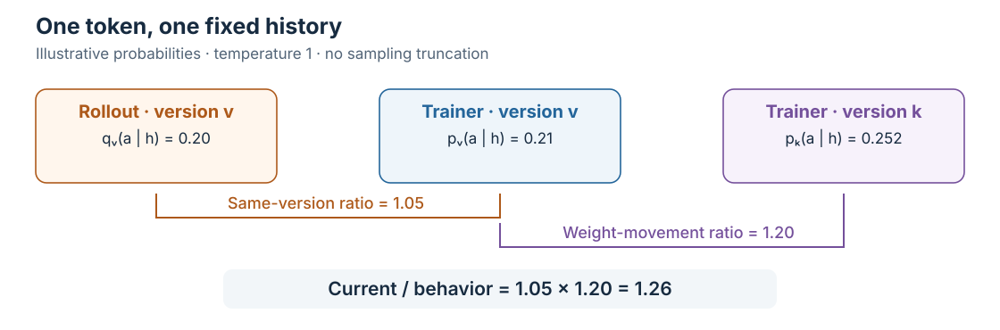
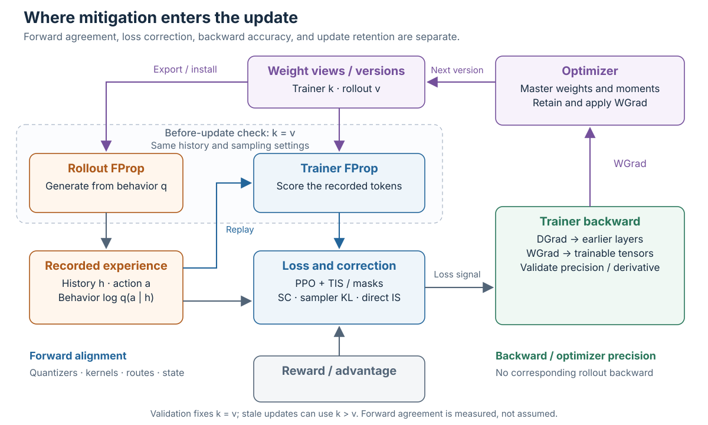
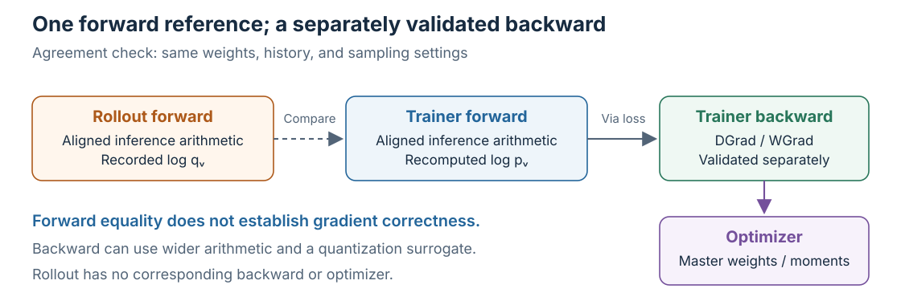
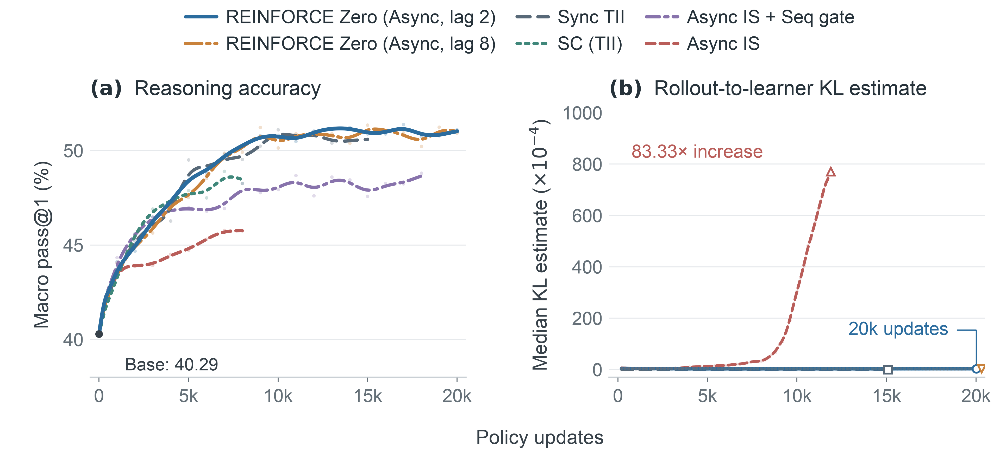
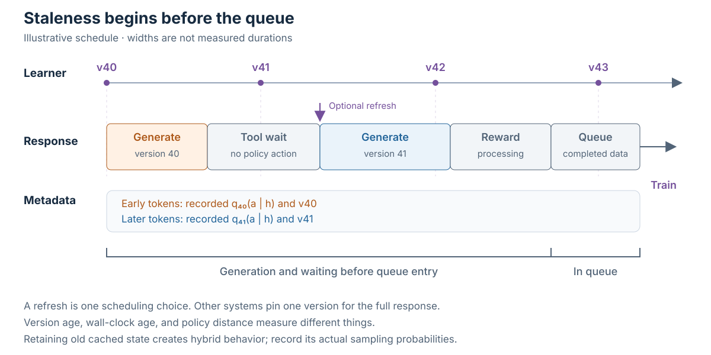

## Why rollout and training disagree {#two-gaps}

A rollout engine samples a token and records its probability. The trainer later scores that token, constructs a loss, and updates the model. The two probabilities need not agree, even before the weights change. They can differ because the engines quantize operands differently, accumulate in a different order, select different experts, or handle cached state differently.

The earlier post, [Low-Precision RL: From Rollout to Update](../low-precision-rl/index.qmd), followed precision through this loop. The next question is what the update should do with the disagreement. PPO/GRPO with rollout correction already provides a practical starting point. Forward numerical alignment, score centering (SC), and REINFORCE Zero make different changes to that starting point.

The disagreement can affect learning even without weight lag: samples arrive in the rollout policy's proportions, while gradients come from the trainer. In the TII report's DeepSeek-V4-Flash experiment, the baseline's train–inference KL grew from about $0.002$ to $29.9$ as reward fell back. That baseline omitted TIS/MIS, so it illustrates a failure mechanism rather than the limits of a tuned correction recipe. [[15]][source-15] Thinking Machines and VeXact use zero-mismatch execution to investigate this numerical effect separately from policy movement. [[1]][source-1] [[2]][source-2]

### Why BF16 and synchronization are incomplete answers

BF16 rollout and synchronous collection are reasonable baselines. They can be affordable for smaller workloads, and they avoid some complications of quantization and policy lag. But using BF16 in both engines does not fix differences in kernel arithmetic or reduction order. Synchronization fixes weight age, not numerical agreement.

Weight storage motivates lower precision: a trillion parameters require about 2 TB in BF16, 1 TB at 8 bits, or 0.5 TB at 4 bits, before scales and exceptions. Savings can support more request state or rollout replicas. MoE sparsity reduces activated computation, while the full expert set still needs storage. Speedups depend on kernels, shapes, and conversion overhead.

Asynchronous collection addresses another cost: waiting. Long generations, tools, and uneven response lengths make a batch ready only when its required work finishes. Overlapping collection with training can improve utilization while making the experience older. AReaL explicitly combines asynchronous collection with staleness control and a modified objective. [[3]][source-3]

Model size alone predicts neither the benefit nor the lag. Even a fast small-model learner can advance many versions during a long rollout. Resource use, waiting time, update frequency, and realized policy distance determine the tradeoff.

### One token, two discrepancies

Fix a history $h$ and action token $a$. Let $q_v$ be the actual rollout policy at generating version $v$, and let $p_v$ and $p_k$ be trainer evaluations at the generating and current weight versions. Use matching sampling transformations for the comparison. The log-ratio splits exactly:

$$
\log\frac{p_k(a\mid h)}{q_v(a\mid h)}
=
\underbrace{\log\frac{p_k(a\mid h)}{p_v(a\mid h)}}_{\text{weight movement}}
+
\underbrace{\log\frac{p_v(a\mid h)}{q_v(a\mid h)}}_{\text{same-version forward disagreement}}.
$$ {#eq-two-gaps}

The intermediate $p_v$ fixes the trainer execution context while changing weights. This comparison depends on the chosen context; neither term is itself a KL divergence.

*Figure 1. An illustrative fixed-history comparison, with temperature 1 and no sampling truncation. The observed ratio combines numerical disagreement and weight movement.*

A current/rollout ratio away from one is expected after learning; a same-version gap measures numerical disagreement.

The rest of the post follows that update:

- [What the usual corrections assume](#baseline): PPO/GRPO, TIS, masking, and policy anchors.
- [From correction to forward alignment](#forward-alignment): the connection to the earlier low-precision analysis.
- [Score centering and sampler KL](#score-centering): remove drift and control the remaining distance.
- [REINFORCE Zero](#reinforce-zero): align the forward and use unclipped correction.
- [What token-level correction leaves unresolved](#staleness): visited histories, continuation credit, and collection delays.

## What the usual corrections assume {#baseline}

### Sampling correction and proximal update control

Let $q$ be the behavior distribution, $\pi_0$ the trainer anchor frozen while consuming a batch, and $p=p_\theta$ the live trainer. Define two ratios:

$$
w(a\mid h)=\frac{\pi_0(a\mid h)}{q(a\mid h)},
\qquad
r(a\mid h)=\frac{p(a\mid h)}{\pi_0(a\mid h)},
\qquad
wr=\frac pq.
$$ {#eq-two-ratios}

**Sampling-distribution correction** reweights data from $q$ toward the anchor $\pi_0$. At a fixed history, $w=\pi_0/q$ gives $\mathbb E_q[w f]=\mathbb E_{\pi_0}[f]$ for a fixed integrand with support coverage.

**Proximal update control** moderates movement from $\pi_0$ through $r=p/\pi_0$. PPO's clipped surrogate gates contributions according to $r$ and the advantage sign. When $q=\pi_0$, no separate sampling correction is needed. GRPO changes advantage estimation while retaining this control. [[4]][source-4] [[5]][source-5]

The TIS extension supplies a separate correction. With detached advantage $A$ and $\bar w=\operatorname{sg}[\min(w,C)]$, a token-local loss is

$$
L_{\mathrm{PPO+TIS}}
=-\mathbb E_{a\sim q}\left[
\bar w\,
\min\left(
rA,\operatorname{clip}(r,1-\epsilon_l,1+\epsilon_h)A
\right)
\right].
$$ {#eq-ppo-tis}

Truncated importance sampling (TIS) caps a weight; masked importance sampling (MIS) retains the original weight inside an accepted interval and discards it outside:

$$
w_{\mathrm{TIS}}=\min(w,C),
\qquad
w_{\mathrm{MIS}}=w\,\mathbf 1[\ell\le w\le u].
$$

TIS limits a large contribution while retaining feedback; MIS selects which contributions remain eligible. Both generally introduce bias. IcePop combines an interval-mask correction with PPO-style control, and Miles supports both TIS and MIS in its SC path. Masks and reduction over tokens and responses must be specified separately. [[6]][source-6] [[7]][source-7] [[14]][source-14]

These controls interact, but truncating $w$ and clipping the surrogate in $r$ is not equivalent to clipping their product.

In Figure 1, suppose the anchor is the historical trainer, $\pi_0=p_v$. The correction $w=1.05$ adjusts for collecting a token with probability $0.20$ when the anchor assigns $0.21$. The movement ratio $r=1.20$ compares the current trainer's $0.252$ with that anchor's $0.21$. Before any update, $r$ would be one even though $w$ already differs from one. PPO's trainer/anchor comparison does not by itself reveal the forward disagreement.

An asynchronous recipe may choose a recent proximal anchor rather than the historical trainer at generation. AReaL uses parameters before the training update. Its anchor/behavior ratio therefore need not isolate same-version numerics. [[3]][source-3]

### What correction does—and what it leaves

At one fixed history, holding the conditional advantage function fixed, exact action importance sampling gives

$$
\mathbb E_{a\sim q}\left[
\frac{p(a)}{q(a)}A(a)\nabla_\theta\log p(a)
\right]
=
\mathbb E_{a\sim p}\left[A(a)\nabla_\theta\log p(a)\right].
$$ {#eq-conditional-is}

This requires $q(a)>0$ wherever the target integrand has support. The denominator must describe the distribution that actually sampled the token, including temperature and filtering. Re-scoring a newer model does not recover that historical probability.

The identity is conditional. Recorded histories were visited under the behavior process; returns and advantages may reflect its continuations. Changing action weights at those histories does not automatically reconstruct current-policy trajectories. Full-response correction involves products of ratios and can be difficult to estimate reliably.

Truncation and masking accept bias to limit extreme contributions. PPO clipping gates selected contributions rather than enforcing a hard probability bound. A reference-KL penalty discourages movement from a separate fixed policy; optimizer gradient clipping acts on the aggregate parameter gradient.

This baseline can be sufficient when ratio tails remain manageable, useful feedback survives, and held-out learning improves within the compute budget.

Sidebar: several different meanings of “decoupling”

PPO (2017) enabled controlled reuse through its surrogate; GRPO (2024) replaced a learned baseline with group-relative credit. DAPO's March 2025 Clip-Higher separates lower and upper PPO bounds. CISPO, introduced with MiniMax-M1 in June, clips a detached weight multiplying log-probability: a token can retain a direct gradient after PPO would gate its contribution off. Both predate the public TIS exposition. [[4]][source-4] [[5]][source-5] [[8]][source-8] [[9]][source-9]

TIS and IcePop separate rollout correction from proximal control. Later direct current/behavior losses can dispense with a separate trainer anchor. These are distinct changes, not a single sequence of replacements. Numerical alignment develops alongside them; SC changes the score contribution rather than merely choosing another clipping interval.

## From correction to forward alignment {#forward-alignment}

The previous article's Unified FP8 example provides a concrete bridge. Its four-way trainer ablation holds FP8 rollout fixed while changing forward operand values, backward operands, and GEMM implementation. [[10]][source-10]

| Numerical configuration | Trainer FProp | Trainer DGrad/WGrad |
| :--- | :--- | :--- |
| BF16 trainer / FP8 rollout | Ordinary BF16 values and GEMMs | Ordinary BF16 |
| Forward fake quantization | FP8 quantize–dequantize values, BF16 GEMMs | Ordinary BF16 |
| Forward and backward fake quantization | FP8 quantize–dequantize values, BF16 GEMMs | Quantized operand values, BF16 GEMMs |
| Native FP8 operations | Eligible GEMMs consume FP8 codes and scales | Eligible FP8 GEMMs |

TIS can accompany each configuration; the table isolates numerical choices from the loss correction.[^fp8-ablation]

[^fp8-ablation]: The source uses TIS clip fraction as a mismatch diagnostic. That plot does not by itself specify the correction applied in every run.

The study reports better agreement when the trainer forward uses quantized values. Backward fake quantization changes gradient operands; native FP8 additionally changes kernels, layouts, accumulation, and conversions. [[10]][source-10]

### The forward defines the scored policy

For a differentiable trainer forward with logits $z_\theta(h)$,

$$
\nabla_\theta L
=
\left(\frac{\partial z_\theta}{\partial\theta}\right)^\top
\frac{\partial L}{\partial z}.
$$ {#eq-update-chain}

Forward quantization changes the probabilities used to construct the objective. Backward arithmetic changes the computed derivative. Loss corrections change the signal propagated through that derivative.

A discrete quantizer commonly uses a **straight-through estimator (STE)**. With fixed scales, rounding has zero derivative almost everywhere. An identity STE uses quantized values in forward but passes the gradient through as if that operation were an identity. One expression is

$$
\widehat x=x+\operatorname{sg}\!\left(DQ(Q(x))-x\right).
$$

Its forward value is $DQ(Q(x))$, while its backward derivative with respect to $x$ is one. Other surrogates mask clipped regions or use different approximations. This deliberately chosen derivative is not an unbiased-gradient guarantee or the literal derivative of rounding. Bengio et al. discuss the straight-through estimator as a heuristic for propagating gradients through hard operations. [[25]][source-25]

Backward quantization cannot retroactively alter probabilities already computed for the current update. It can change the gradient and therefore the next policy. There is no rollout backward path to match. The engineering requirement is a useful, validated derivative, not identical trainer and rollout backward computation.

*Figure 2. The dashed region is a same-version forward-validation check: set $k=v$ and hold the recorded history, token positions, and sampling transformations fixed before an update. Equal weight versions do not imply equal probabilities; agreement is what the check measures. The broader lifecycle also supports stale-data updates with $k>v$. Backward and optimizer correctness are separate requirements. DGrad carries sensitivity to earlier layers; WGrad supplies trainable-parameter gradients to the optimizer. The loss-box entries are recipe choices, not one combined loss.*

Matching represented values is also narrower than matching executed arithmetic. BF16 GEMMs on QDQ operands can approximate native FP8 operands while differing in accumulation or scale application. Attention, expert merging, and request state add further boundaries.

Sidebar: other ways to reduce trainer–rollout disagreement

| Technique | Boundary it addresses | What it does not establish |
| :--- | :--- | :--- |
| **Rollout Routing Replay (R3)** | Record rollout-selected expert IDs and replay their selection during trainer evaluation; gate weights remain recomputed and differentiable. [[24]][source-24] | Identical hidden states, gate weights, expert arithmetic, or whole-policy probabilities |
| **Sensitive-operation precision** | Use wider arithmetic where probability computation is sensitive; Miles' SC path enables an FP32 rollout LM head. [[14]][source-14] | End-to-end numerical agreement |
| **Token-in-token-out (TITO)** | Preserve sampled token IDs and action boundaries rather than reconstructing them through a text/tokenization round trip. [[21]][source-21] | Matching forward arithmetic |
| **Cache and recurrent-state consistency** | Keep request state compatible with active weights and execution history; AReaL recomputes KV state after an in-flight refresh. [[3]][source-3] | A correction for genuine policy movement |

R3 is particularly useful when a small numerical perturbation changes a discrete expert selection. The other techniques address probability precision, data correspondence, or state consistency. These documented implementation choices can complement quantization alignment and loss correction. Batch-invariant kernels are discussed with TII below.

Higher-precision master weights and moments remain independent choices. They can preserve small updates even when forward operands are low precision. Alignment asks whether the two forward paths represent the intended policy at a snapshot; optimizer precision asks how well the next snapshot is produced.

That leaves two routes to examine. One changes the update under the residual disagreement. The other pushes forward agreement further before applying correction.

## Score centering: remove drift, then control distance {#score-centering}

### A sampler-expected trainer score

Fix a history and write $s(a)=\nabla_\theta\log p_\theta(a)$. For a normalized differentiable distribution,

$$
\mathbb E_p[s]
=\sum_a p(a)\nabla_\theta\log p(a)
=\sum_a\nabla_\theta p(a)
=0.
$$

The expectation under $q$ need not vanish. Holding $q$ and the conditional advantage function fixed, expand the raw contribution:

$$
\mathbb E_q[A s]
=
\operatorname{Cov}_q(A,s)
+
\underbrace{\mathbb E_q[A]\mathbb E_q[s]}_{\text{conditional mean-score drift}}.
$$ {#eq-score-drift}

SC subtracts the sampler-expected score:

$$
\widetilde s(a)=s(a)-\mathbb E_q[s],
\qquad
g_{\mathrm{SC}}
=\mathbb E_q[A\widetilde s]
=\operatorname{Cov}_q(A,s).
$$ {#eq-score-centering}

The operation removes the second term. It does not change the remaining covariance into $\operatorname{Cov}_p(A,s)$. Group reward centering does not generally make the conditional mean advantage zero at every prefix. The paper and reference implementation distinguish exact centering from practical reconstruction. [[11]][source-11] [[12]][source-12]

For independently parameterized softmax logits, $\nabla_z\log p_a=e_a-p$, so

$$
\mathbb E_q[\nabla_z\log p_a]=q-p,
\qquad
\widetilde s_z(a)=e_a-q.
$$

The uncorrected expected logit contribution is

$$
g_{\mathrm{raw},j}=q_j A_j-p_j\bar A_q
=q_j(A_j-\bar A_q)+\bar A_q(q_j-p_j).
$$

For a constant conditional advantage $c$, the raw contribution is $c(q-p)$ despite there being no relative action credit. Exact SC makes it zero. A transformer's update additionally passes through its shared Jacobian and optimizer.

### Why sampler KL can complement centering

With a frozen sampler, minimizing $D_{\mathrm{KL}}(q\|p)$ contributes

$$
-\beta\nabla_\theta D_{\mathrm{KL}}(q\|p)
=\beta\,\mathbb E_q[s].
$$

Combining it with centering gives the ascent direction

$$
g_{\mathrm{SC+KL}}
=\operatorname{Cov}_q(A,s)+\beta\,\mathbb E_q[s].
$$ {#eq-sc-kl}

The raw update had coefficient $\mathbb E_q[A]$ on the sampler-directed component. SC removes it; the KL penalty adds a chosen coefficient $\beta$, independently of the reward baseline. Zhang develops this sampler-KL extension in a separate analysis; it is not part of the base SC recipe. The penalty encourages proximity without enforcing a hard constraint. [[13]][source-13]

The following calculation uses $p=(0.8,0.2)$, $q=(0.5,0.5)$, and $A=(2,0)$ at one prefix:

| Expected logit contribution | Value |
| :--- | :--- |
| Raw $\mathbb E_q[A s_z]$ | $(0.20,-0.20)$ |
| SC $\operatorname{Cov}_q(A,s_z)$ | $(0.50,-0.50)$ |
| Exact IS $\mathbb E_p[A s_z]$ | $(0.32,-0.32)$ |
| SC plus sampler KL, $\beta=0.2$ | $(0.44,-0.44)$ |

These calculated expectations distinguish cancelling drift from recovering the target-policy expectation. Sampler KL does not make SC equivalent to IS.

An exact value baseline under $q$ would remove the conditional mean advantage and displayed drift in expectation. An estimated critic need not do so; even an exact baseline leaves the sampler-distributed covariance.

### What a practical implementation needs

Selected-token log-probability suffices for an IS ratio. SC also needs the sampler-expected trainer score. The reference implementation stores a top-$k$ head and approximates the remaining sampler mass using a rescaled trainer tail. That reduces metadata at the cost of approximation. The correction coefficients are detached; differentiating through their reconstruction would change the intended update. [[12]][source-12]

SC can also compose with truncated or masked weights. From here onward, the direct correction ratio is $p_\theta/q$, rather than Section 2's anchor/behavior ratio $\pi_0/q$. For a detached token-local weight $w$, possibly truncated or masked, center the weighted score:

$$
\widetilde s_w(a)=w(a)s(a)-\mathbb E_q[w s].
$$ {#eq-weighted-centering}

Multiplying an already-centered unweighted score by $w$ is generally different. With exact $w=p/q$, $\mathbb E_q[ws]=0$; clipped or masked weights need not have that property. The centering distribution and the sampled-token distribution must agree for exact cancellation. [[11]][source-11] [[12]][source-12]

Miles implements weighted centering and enables an FP32 rollout LM head, so selecting SC also changes rollout numerics. Its logged rollout/trainer KL is a detached diagnostic. The documented reference-KL regularizer uses a separate reference policy; neither should be confused with an explicit penalty on $D_{\mathrm{KL}}(q\|p)$ proposed above. [[14]][source-14]

In the SC study's deliberately severe quantization and staleness settings, composing SC with TIS or MIS improves stale-sampler results over SC alone. Those comparisons hold the surrounding objective fixed. [[11]][source-11]

## REINFORCE Zero: align the forward, then correct lag {#reinforce-zero}

The lag correction is **ordinary, unclipped token-level importance sampling**. REINFORCE Zero combines it with TII: alignment removes same-snapshot numerical disagreement, and the ratio accounts for policy movement since generation. Its contribution is making full IS practical through alignment. [[16]][source-16]

### Same weights, same history, same probabilities

Trainer–inference invariance (TII) targets $p_v=q_v$: rollout and trainer agree at the same weights and history, with matching sampling transformations. The engineering report checks bitwise equality of selected-token log-probabilities before updates on its accepted tasks and runtime configurations. [[15]][source-15]

After learning, $p_k/q_v$ can still differ from one. If rollout and the historical trainer both assign a token probability $0.20$, while the current trainer assigns $0.24$, TII holds and the importance weight is $1.20$. The same-version term in @eq-two-gaps has vanished; the remaining ratio measures weight movement within the aligned configuration.

### Why sharing the forward takes engineering

Rollout generates incrementally through cached state; training scores recorded tokens in larger parallel batches. Even a deterministic kernel can choose different arithmetic for those shapes. The TII report's DeepSeek-V4 recipe illustrates three places where agreement requires changing the fast path:

| Source of disagreement | Concrete engineering choice in the report |
| :--- | :--- |
| Batch-dependent GEMMs | Remove small-batch backend switches and use batch-invariant accumulation. |
| Prefill versus decode | Keep FP8 KV storage, but make decode and training reproduce the same cache rounding and attention read path as prefill. |
| Distributed execution | Use TP1 and accumulate returned expert outputs locally in a fixed order, allowing different EP degrees without a different distributed sum. |

These are configuration-specific choices, not universal requirements on every aligned implementation. They show why matching quantizers or importing a kernel does not finish the job: agreement must survive batch changes, execution phases, and communication layouts. Some faster branches and supported topologies can be lost. [[15]][source-15]

The report's central decision is that **inference kernels define forward values; training supplies the backward**. Each module wraps the inference operation in custom autograd support. Existing backward kernels are reused where possible, and FP8 quantization uses the STE introduced in Section 3. For some fused operations, a separate differentiable recomputation supplies gradients while the inference kernel still supplies the visible values. This preserves the serving numerical path without requiring serving kernels to implement training themselves. [[15]][source-15]

*Figure 3. Forward-value agreement and gradient validation are separate requirements. The comparison fixes the weight version; an asynchronous training batch can still contain older rollout versions. The backward may use wider arithmetic or a quantization surrogate.*

Bitwise forward agreement therefore establishes nothing by itself about gradient correctness. The report checks gradients against an independent reference; it also checks weight-version consistency between forward and backward. Saving inference intermediates increases training memory pressure, and its recipe uses full recomputation. Wider backward arithmetic and optimizer master weights can coexist with the aligned forward, but they require their own validation. [[15]][source-15]

### Why alignment can make unclipped IS practical

At a fixed history, exact IS can correct either numerical disagreement or weight lag, assuming support coverage and a fixed advantage function. The ratio does not distinguish their causes. What can fail is the usefulness of a finite batch: its second moment remains sensitive to how behavior covers the target:

$$
\mathbb E_q\!\left[\|w A s\|^2\right]
=\sum_a\frac{p(a)^2}{q(a)}A(a)^2\|s(a)\|^2.
$$ {#eq-is-second-moment}

A rare behavior action can receive a large contribution when the current policy assigns it more probability. The ratio-only moment is $\mathbb E_q[w^2]=\exp D_2(p\|q)$, with $D_2$ the order-two Rényi divergence, but advantage/score correlation also matters. A small average ordinary KL is not a bound on this moment.

TIS limits extreme contributions after the ratio is formed, accepting bias. Alignment instead removes a source of disagreement before weighting. The hypothesis behind REINFORCE Zero is that the remaining weight movement is manageable with full correction in its tested asynchronous regimes. Large policy movement can still produce extreme weights; alignment is not a guarantee for arbitrary lag.

The paper's Gaussian example makes the optimization consequence explicit: mismatch raises update variance and narrows the stable step-size range even when IS preserves the mean gradient. A correct expected direction can coexist with growing expected squared error. This explains a mechanism; it is not a convergence theorem for transformers with Adam or group-estimated advantages. [[17]][source-17]

### The update after alignment

REINFORCE Zero pairs TII with unclipped token-level IS and group-mean advantages. Writing $B$ for responses and $T_i$ for valid action-token counts, its reported loss is

$$
\widehat L(\theta)
=-\frac1B\sum_{i=1}^{B}\frac1{T_i}
\sum_{t=1}^{T_i}
A_i\,\frac{p_\theta(a_{it}\mid h_{it})}{q_{it}(a_{it}\mid h_{it})},
\qquad
A_i=R_i-\operatorname{mean}_{j\in\mathcal G(i)}R_j.
$$ {#eq-reinforce-zero-loss}

Here the target is the current learner $p_\theta$, and $q_{it}$ is the recorded generating policy for that token. There is no separate PPO anchor in this loss. Token averaging within each response followed by response averaging is part of its definition; the main recipe has no additional token or sequence rejection gates. [[16]][source-16]

The numerator remains differentiable while advantages, stored denominators, and lengths are fixed. For $w_{it}=p_\theta/q_{it}$,

$$
\begin{aligned}
\nabla_\theta w_{it}
&=w_{it}\nabla_\theta\log p_\theta(a_{it}\mid h_{it}),\\[0.5em]
-\nabla_\theta\widehat L
&=\frac1B\sum_i\frac1{T_i}\sum_t
A_iw_{it}\nabla_\theta\log p_\theta(a_{it}\mid h_{it}).
\end{aligned}
$$ {#eq-reinforce-zero-gradient}

This is why the loss contains a ratio without an explicit log-probability factor. A ratio numerically equal to one still has a gradient through its numerator. Exact IS also gives $\mathbb E_q[ws]=0$, removing the score-mean drift discussed in Section 4 while recovering the target conditional action expectation. Token correction still leaves prefix visitation and stale continuation credit unresolved. [[16]][source-16]

### What the reported comparison establishes

*Figure 4. Original REINFORCE Zero Figure 1, as published in the authors' November 6 announcement. DeepSeek-R1-Distill-Qwen-1.5B mathematical-reasoning experiments compare aligned REINFORCE Zero with standard-kernel IS and other correction settings. The paired panels show reasoning quality and rollout-to-learner KL; curves retain the source's smoothing and evaluation protocol. [[17]][source-17] [[18]][source-18]*

The paper reports continued learning over 20,000 updates at lag settings 2 and 8. These main mathematical-reasoning experiments use BF16, illustrating that alignment addresses more than quantization. Its equal-update timing comparison uses 16 GPUs and 12,000 updates: asynchronous REINFORCE Zero achieves 2.40× the training-step throughput of synchronous TII, excluding evaluation. Both use alignment, so this comparison measures the benefit of asynchronous execution. The SC comparison uses aligned execution, top-32 centering, and no IS; it does not evaluate the full SC-plus-sampler-KL family. [[17]][source-17]

Alignment results on flagship architectures should also be separated from long asynchronous learning results. The announcement describes DeepSeek-V4.1-Flash and Kimi K3.1 alignment checks while identifying longer async runs on them as subsequent work. [[18]][source-18]

The TorchTitan hybrid-attention study reports workload-dependent benefits and substantial costs for its batch-invariant implementation, mostly with one seed. Its async runs retain cached state across weight refreshes, producing hybrid behavior that differs from a clean snapshot; Section 6 explains the distinction. Its costs and outcomes therefore need to be read with that state policy as well as its kernels. [[19]][source-19]

A kernel replacement needs both forward-agreement regression and backward/update validation. It can preserve existing outputs or establish a new jointly validated pair across the supported batches, states, shapes, and weight-publication paths.

## What token-level correction leaves unresolved {#staleness}

IS corrects conditional action frequencies at recorded histories. It does not make those histories, subsequent continuations, or terminal rewards newly sampled from the current policy. Three remaining issues concern where experience came from, which state generated it, and how long collection took.

### Visited histories and continuation credit

A response contains prefixes selected by its generating policies. Weighting one recorded token by $p_\theta/q$ does not change how often those prefixes were visited or what would have happened after choosing a different action. Its terminal reward still evaluates the recorded continuation. Full-trajectory correction requires accounting for that path; token-level weighting alone does not establish a current-policy trajectory gradient.

### Mixed versions and cached state

*Figure 5. An illustrative schedule with an optional mid-response refresh. Other systems pin one version for the full response. Widths do not represent measured durations; version age and elapsed time are separate measurements.*

With in-flight refreshes, each token retains its generating probability. For the recorded version/state execution trace $\mathcal E$, the policy-action likelihood factors are

$$
\mathcal L_{\mathrm{actions}}(\tau;\mathcal E)
=\prod_{t\in\text{policy actions}}
\mu(a_t\mid h_t;v_t,C_t),
$$

where $C_t$ denotes cached request state. Environment and scheduling factors are omitted. A single checkpoint need not describe the whole response. Keeping state built under older weights creates hybrid behavior; its recorded probabilities remain valid if they describe the actual execution.

AReaL discards old KV state and recomputes after a refresh, restoring each segment to its active snapshot's policy. The TorchTitan study instead retains the cache to avoid re-prefill. Snapshot alignment and hybrid-state behavior require different comparisons; a weight-version label alone cannot identify the latter. [[3]][source-3] [[19]][source-19] GLM-5's TITO gateway preserves token correspondence and records the versions involved in asynchronous responses. [[21]][source-21]

### Collection delays and credit estimation

Generation, tool waits, group completion, and reward processing all create age before queue entry. Queue residence adds another interval. Applied Compute models this pre-queue/in-queue split for a GRPO pipeline. Shrinking a queue cannot remove time already spent collecting the response; age cutoffs can also change which tasks and lengths survive. [[20]][source-20]

SAO changes collection and credit estimation together: one rollout per prompt removes group-completion waiting, while a learned critic supplies advantages and direct double-sided ratio masking controls off-policy contributions. This trades group sampling for critic cost; the learner can still batch many prompts. [[22]][source-22]

Related implementation: MiMo's direct rollout correction

MiMo-V2.6 also uses direct current/recorded-rollout ratios, with detached weights and advantage-sign-dependent masks. Partial rollouts keep their generation-time probabilities. This illustrates a direct-ratio recipe with sample selection, rather than REINFORCE Zero's unclipped update. [[23]][source-23]

### Comparing complete choices

| Choice | Main intervention | What remains to assess |
| :--- | :--- | :--- |
| PPO/GRPO plus TIS or masks | Separate behavior correction from proximal update control | Truncation/selection bias, useful sample retention, and stale credit |
| Correction plus forward QDQ | Reduce quantization-value disagreement before correction | Remaining arithmetic/state mismatch and gradient quality |
| SC with optional weighted centering and sampler KL | Remove conditional drift and control residual distance | Sampler-distributed covariance, reconstruction error, and regularization cost |
| TII plus unclipped IS | Remove validated same-version forward mismatch and apply full lag weights | Alignment cost/maintenance, lag-induced variance, and trajectory-distribution effects |

These choices overlap. SC can compose with weighted correction; QDQ can be part of an aligned forward; scheduling controls matter with either featured approach. The evidence should compare complete recipes at a defined resource budget.

For numerical agreement, score identical histories at the same snapshot. For stale-data behavior, examine age distributions alongside ratio tails, divergence, and rejected contributions. For learning, track held-out outcomes against wall time or GPU-hours, including the cost of metadata, alignment, and discarded experience. Lower KL, more tokens per second, and zero mismatch are informative intermediate measurements. Their value comes from the learning they enable.

## Technical note: reconstruction and local bounds {.unnumbered}

For a stored candidate head $H$, using $j$ for vocabulary indices, a common reconstruction is

$$
\widehat q_j=
\begin{cases}
q_j,&j\in H,\\
\rho p_j,&j\notin H,
\end{cases}
\qquad
\rho=\frac{1-\sum_{j\in H}q_j}{1-\sum_{j\in H}p_j}.
$$

Assume a positive trainer tail mass; practical implementations need guards for degeneracy. This matches the observed head and total tail mass, not the unknown tail shape. With normalized $p$, $\sum_j p_j s_j=0$ lets the expected score be expressed through head terms. The corresponding unweighted loss is

$$
L_{\mathrm{SC}}
=-A\left[
\log p_a-\sum_{j\in H}
\operatorname{sg}(q_j-\rho p_j)\log p_j
\right].
$$

Detaching the coefficient is essential. The actual sampled action retains its recorded probability when a ratio is needed, including outside the stored head. Filtering the sampling support is a different issue from approximating an unfiltered tail. [[12]][source-12] [[14]][source-14]

For a local SC comparison, let $b_q=\mathbb E_q[A]$ and assume $\|(A(a)-b_q)s(a)\|\le M$. Since $\mathbb E_p[s]=0$,

$$
\begin{aligned}
g_{\mathrm{SC}}-g_p
&=\sum_a(q(a)-p(a))(A(a)-b_q)s(a),\\
\|g_{\mathrm{SC}}-g_p\|
&\le M\|q-p\|_1
\le M\sqrt{2D_{\mathrm{KL}}(q\|p)}.
\end{aligned}
$$

This motivates controlling distribution distance. It holds at a fixed history with a fixed conditional advantage function and bounded integrand; the bound can be loose. Neither a soft KL penalty nor this inequality establishes a global on-policy trajectory gradient or long-run convergence. [[13]][source-13]

## References {.unnumbered}

::: {.references-list}

1. He, H. and Thinking Machines Lab (2025). *Defeating Nondeterminism in LLM Inference.* [Technical article](https://thinkingmachines.ai/blog/defeating-nondeterminism-in-llm-inference/)
2. Zhong, T. et al. (2026). *Diagnosing Training-Inference Mismatch in LLM Reinforcement Learning via a Zero-Mismatch Reference.* [arXiv:2605.14220v2](https://arxiv.org/html/2605.14220v2)
3. Fu, W. et al. (2025). *AReaL: A Large-Scale Asynchronous Reinforcement Learning System for Language Reasoning.* [arXiv:2505.24298v1](https://arxiv.org/html/2505.24298v1)
4. Schulman, J. et al. (2017). *Proximal Policy Optimization Algorithms.* [arXiv:1707.06347](https://arxiv.org/abs/1707.06347)
5. Shao, Z. et al. (2024). *DeepSeekMath: Pushing the Limits of Mathematical Reasoning in Open Language Models.* [arXiv:2402.03300v1](https://arxiv.org/html/2402.03300v1)
6. Yao, F. et al. (2025). *On the Rollout-Training Mismatch in Modern RL Systems.* [Workshop report](https://opt-ml.org/papers/2025/paper116.pdf)
7. Ling Team et al. (2025). *Every Step Evolves: Scaling Reinforcement Learning for Trillion-Scale Thinking Model.* [arXiv:2510.18855v1](https://arxiv.org/html/2510.18855v1)
8. Yu, Q. et al. (2025). *DAPO: An Open-Source LLM Reinforcement Learning System at Scale.* [arXiv:2503.14476v1](https://arxiv.org/html/2503.14476v1)
9. MiniMax (2025). *MiniMax-M1: Scaling Test-Time Compute Efficiently with Lightning Attention.* [arXiv:2506.13585v1](https://arxiv.org/html/2506.13585v1)
10. InfiXAI, Ant Group AQ, SGLang RL, and Miles teams (2025). *Unified FP8: Moving Beyond Mixed Precision for Stable and Accelerated MoE RL.* [Technical article](https://www.lmsys.org/blog/2025-11-25-fp8-rl/)
11. Marek, M. and Ryabinin, M. (2026). *Score Centering Stabilizes Off-policy Reinforcement Learning.* [arXiv:2609.20807v1](https://arxiv.org/html/2609.20807v1)
12. Marek, M. *Score Centering reference implementation.* [Repository](https://github.com/martin-marek/score-centering)
13. Zhang, Y. (2026). *Score Function Centering: Why a Stale Rollout Does Not Have to Be Importance Sampled.* [Derivation](https://normaluhr.github.io/en/p/score-function-centering-kl/)
14. Miles. *Score Centering.* [Documentation](https://miles.radixark.com/docs/examples/infra-features/score-centering), checked 2026-11-08.
15. Bai, Y. and Shen, A. (2026). *Finish RL Training Faster: Bitwise-Consistent, High-Performance, Agent-Driven.* [Engineering report](https://vllm-project.github.io/2026/10/14/train-inference-consistency.html)
16. REINFORCE Zero authors (2026). *Algorithm and gradient guide.* [Pinned revision](https://github.com/hijkzzz/REINFORCE-Zero/blob/ac19d189c4caaa4a5946146bd3eeaef3db244719/ALGORITHM.md)
17. Hu, J. et al. (2026). *REINFORCE Zero: Stable Asynchronous RL with Importance Sampling.* [Paper, pinned revision](https://github.com/hijkzzz/REINFORCE-Zero/blob/ac19d189c4caaa4a5946146bd3eeaef3db244719/REINFORCE-Zero.pdf)
18. Shen, A. et al. (2026). *Zero Mismatch, Simple Async RL: REINFORCE Zero, DeepSeek-V4.1 and Kimi K3.1.* [Announcement and Figure 1 source](https://vllm-project.github.io/2026/11/06/zero-mismatch-async-rl.html)
19. Wang, Y. and TorchTitan team (2026). *Defending Against the Training–Inference Numeric Mismatch in RL (Especially Linear Attention) — and Whether It Helps Async RL.* [Engineering analysis](https://yichuan-w.github.io/blog/GDN-train-inference-mismatch-asyncRL/)
20. Dong, C., Goel, A., and Yu, D. (2026). *Predicting and Controlling Staleness in Fully Asynchronous RL Training.* [Applied Compute analysis](https://appliedcompute.network/research/staleness-in-fully-async-rl)
21. GLM-5 Team (2026). *GLM-5: from Vibe Coding to Agentic Engineering.* [arXiv:2602.15763v1](https://arxiv.org/html/2602.15763v1)
22. Hou, Z. et al. (2026). *Single-Rollout Asynchronous Optimization for Agentic Reinforcement Learning.* [arXiv:2607.07508v1](https://arxiv.org/html/2607.07508v1)
23. Xiaomi MiMo (2026). *MiMo-V2.6: Scaling Reinforcement Learning Towards Self-Improvement.* [arXiv:2610.11959v1](https://arxiv.org/html/2610.11959v1)
24. Ma, W. et al. (2025). *Stabilizing MoE Reinforcement Learning by Aligning Training and Inference Routers.* [R3 paper, arXiv:2510.11370v1](https://arxiv.org/html/2510.11370v1)
25. Bengio, Y., Léonard, N., and Courville, A. (2013). *Estimating or Propagating Gradients Through Stochastic Neurons for Conditional Computation.* [arXiv:1308.3432](https://arxiv.org/abs/1308.3432)

:::

[source-1]: https://thinkingmachines.ai/blog/defeating-nondeterminism-in-llm-inference/
[source-2]: https://arxiv.org/html/2605.14220v2
[source-3]: https://arxiv.org/html/2505.24298v1
[source-4]: https://arxiv.org/abs/1707.06347
[source-5]: https://arxiv.org/html/2402.03300v1
[source-6]: https://opt-ml.org/papers/2025/paper116.pdf
[source-7]: https://arxiv.org/html/2510.18855v1
[source-8]: https://arxiv.org/html/2503.14476v1
[source-9]: https://arxiv.org/html/2506.13585v1
[source-10]: https://www.lmsys.org/blog/2025-11-25-fp8-rl/
[source-11]: https://arxiv.org/html/2609.20807v1
[source-12]: https://github.com/martin-marek/score-centering
[source-13]: https://normaluhr.github.io/en/p/score-function-centering-kl/
[source-14]: https://miles.radixark.com/docs/examples/infra-features/score-centering
[source-15]: https://vllm-project.github.io/2026/10/14/train-inference-consistency.html
[source-16]: https://github.com/hijkzzz/REINFORCE-Zero/blob/ac19d189c4caaa4a5946146bd3eeaef3db244719/ALGORITHM.md
[source-17]: https://github.com/hijkzzz/REINFORCE-Zero/blob/ac19d189c4caaa4a5946146bd3eeaef3db244719/REINFORCE-Zero.pdf
[source-18]: https://vllm-project.github.io/2026/11/06/zero-mismatch-async-rl.html
[source-19]: https://yichuan-w.github.io/blog/GDN-train-inference-mismatch-asyncRL/
[source-20]: https://appliedcompute.network/research/staleness-in-fully-async-rl
[source-21]: https://arxiv.org/html/2602.15763v1
[source-22]: https://arxiv.org/html/2607.07508v1
[source-23]: https://arxiv.org/html/2610.11959v1
[source-24]: https://arxiv.org/html/2510.11370v1
[source-25]: https://arxiv.org/abs/1308.3432
